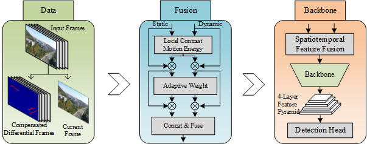
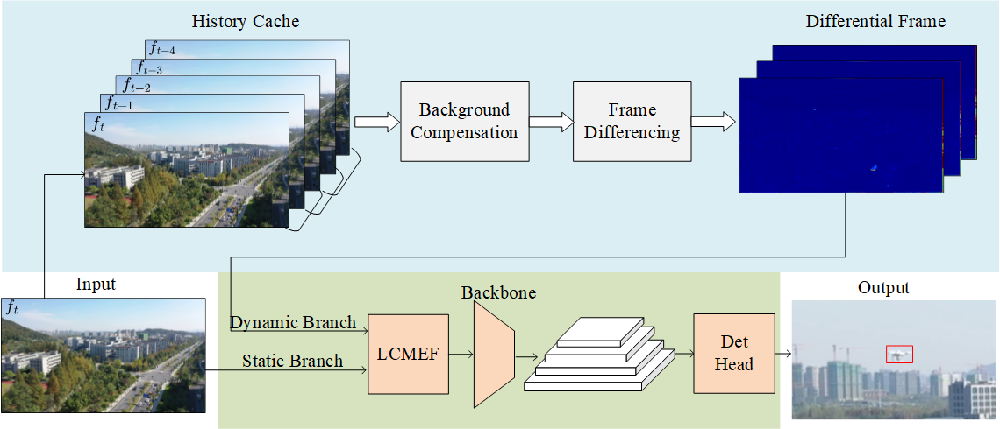

## Introduction

This repository serves as the official source code for the paper titled "*Motion-Appearance Synergy: Small and Dim Target Detection in Motion-to-Motion Scenarios - A Counter-UAV Study*"

Our manuscript is currently under review. The source code will be made publicly available upon publication.

<div align="center"></div>
<div align="center"></div>

## Quick Start

**1. Check Requirements**
* Windows 11 with Python == 3.11.15
* PyTorch == 2.13.0+cu126 & torchvision == 0.28.0+cu126
* CUDA 12.6
* ultralytics 8.4.43

**2. Build MASFF-Net**
* Clone Code
  ```angular2html
  git clone https://github.com/hrdwsong/MASFF-Net
  cd MASFF-Net
  ```
* Create a virtual environment
  ```angular2html
  conda create -n masffnet python=3.11.15
  conda activate masffnet
  ```
* Install PyTorch 2.13.0 with CUDA 12.6
  ```shell
  pip install torch==2.13.0 torchvision==0.28.0 --index-url https://download.pytorch.org/whl/cu126
  ```
* Install ultralytics
  ```shell
  pip install ultralytics==8.4.43
  ```

**3. Prepare Data**
  - We evaluate our models on ARD100 datasets:

    |                                      Dataset                                      |  Size  | Video Number |
    |:---------------------------------------------------------------------------------:|:------:|:------------:|
    | [ARD100](https://pan.baidu.com/s/1iPQiY3RU7LQXqCOMVTlCTQ) (Extraction Code: aswm) | 25.5GB |     100      |


- Unzip the downloaded datasets and copy all images into a folder (e.g.: `C:\datasets\ARD100\test_videos`):
- Extract static frames and dynamic frames from videos:
  ```shell
  python datasets/prepare_3diff_abs_ard100.py
  python datasets/20_percent_sampling.py
  ```

**4. Training and Evaluation**

  ```shell
  #  Training command.
  python train.py
  #  Evaluation command.
  python eval.py
  ```

## Results on ARD100

| Scale   | Para.  |  FLOPs  | Precision |   Recall   | F1-Score | mAP50 | mAP50-95 |
|:--------|:-------|:-------:|:---------:|:----------:|:--------:|:-----:|:--------:|
| Nano    | 2.43M  | 135.4G  |   0.880   | 0.776 |    0.825      |   0.845    |     0.438     |
| Small   | 3.20M  | 210.7G  |   0.906   | 0.799 |    0.849      |   0.856    |     0.443     |
| Medium  | 4.91M  | 368.3G  |   0.928   | 0.829 |    0.876      |   0.891    |     0.478     |
| Large   | 5.81M  | 434.7G  |   0.931   | 0.889 |    0.910      |   0.898    |     0.483     |
| X-Large | 13.04M | 1003.7G |   0.947   | 0.897 |    0.921      |   0.915    |     0.491     |


## Acknowledgement
This repo is developed based on [ultralytics](https://github.com/ultralytics/ultralytics). Please check them for more details and features.


